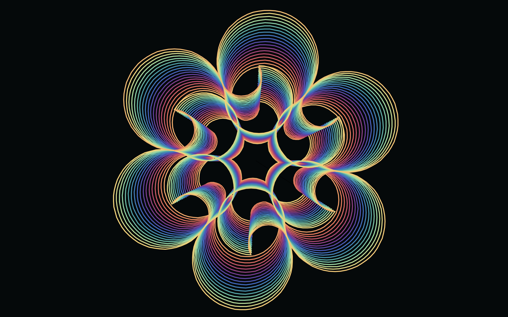

# Mandagen

Two Python programs that generate layered mandalas by drawing circular arcs. The first one `naive.py` uses built-in `circle` which lacks the smoothness of bézier-optimized curves. The second one `bézier.py` uses a chain of cubic Bézier segments, sampled densely so that the stroke stays within a fixed distance of the circle resulting in a smoothed curvature.



## Cubic Bézier curves

A cubic Bézier curve is the path traced by a point that is a weighted blend of four points: a start P0, two control points P1 and P2, and an end P3. The weights are the Bernstein polynomials of degree 3. For a parameter t from 0 to 1:

`B(t) = (1−t)³ P0 + 3(1−t)² t P1 + 3(1−t) t² P2 + t³ P3`

```python
def _bezier_point(p0, p1, p2, p3, t):
    u = 1.0 - t
    uu, tt = u * u, t * t
    return (
        uu * u * p0[0] + 3 * uu * t * p1[0] + 3 * u * tt * p2[0] + tt * t * p3[0],
        uu * u * p0[1] + 3 * uu * t * p1[1] + 3 * u * tt * p2[1] + tt * t * p3[1],
    )
```

## Requirements

- Python 3
- `turtle` and `tkinter` (standard library; on some Linux installs, `tkinter` is a separate package such as `python3-tk`)

## Run

```bash
python naive.py
python bézier.py
```

## License

This project is private and intended for demonstration or personal use.\
See the [LICENSE](LICENSE) file for details.


## Contact

Maintained by tpreisig - feel free to reach out!